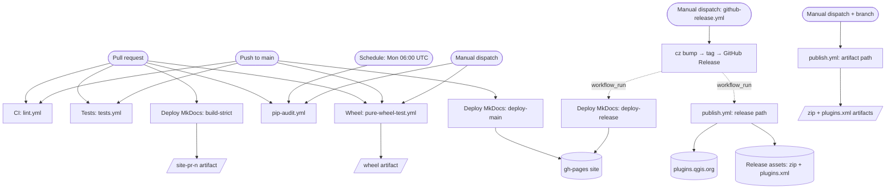
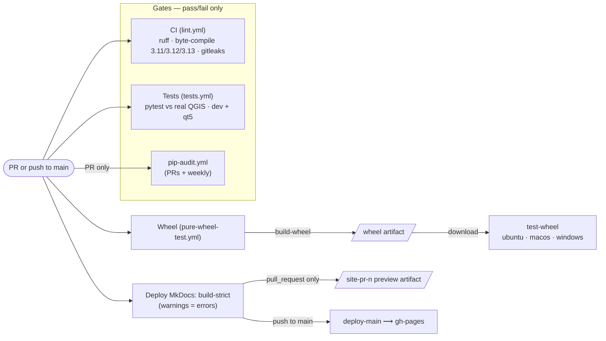
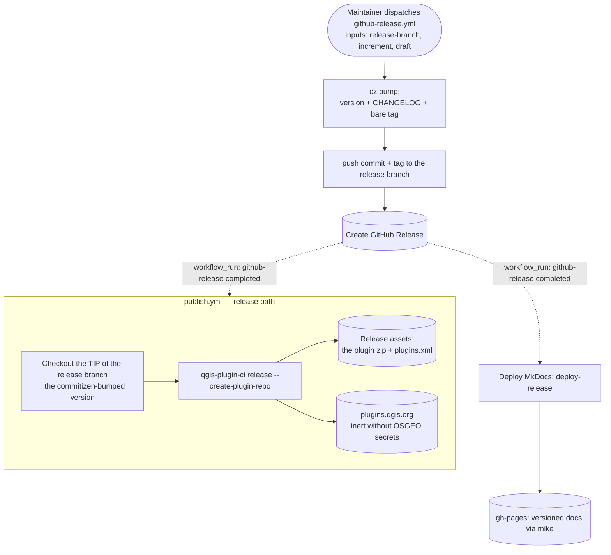
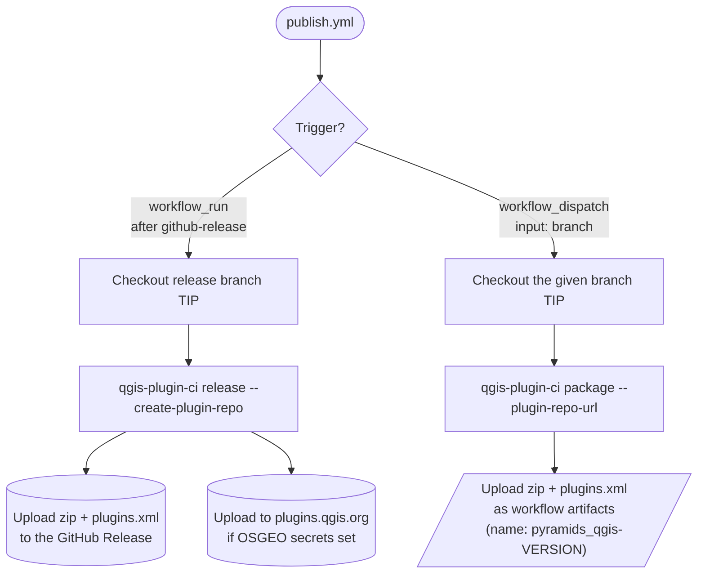
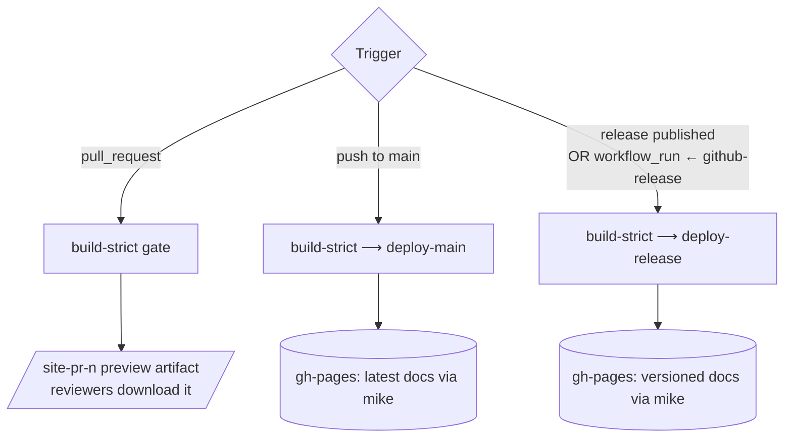

# Continuous integration & delivery

This repository is driven by seven GitHub Actions workflows. This page explains **what triggers each one** and
**where its output goes** — nothing (a pass/fail gate), a run-scoped *workflow artifact*, a *GitHub Release* asset,
the *`gh-pages`* site, or the official *plugins.qgis.org* repository.

> The plugin is **not published to PyPI** — `pyramids-qgis` ships as a QGIS plugin zip. "Publishing" therefore
> means attaching that zip (and a custom-repository `plugins.xml`) to a GitHub Release and uploading it to
> plugins.qgis.org, **not** pushing a wheel to PyPI. (The `Wheel - Build & Test` workflow does build a wheel, but
> only to test the import surface — that wheel is never released.)

## Workflows at a glance

| Workflow | File | Triggers | Output / uploaded to |
|---|---|---|---|
| **CI** | `lint.yml` | push → `main`, pull_request | none — gate only (ruff, byte-compile 3.11/3.12/3.13, gitleaks) |
| **Tests** | `tests.yml` | push → `main`, pull_request | none — gate only (pytest against real QGIS, matrix `dev` + `qt5`) |
| **Wheel - Build & Test** | `pure-wheel-test.yml` | push → `main`, pull_request, workflow_dispatch | **run-scoped artifact** (the built wheel, passed build → test across ubuntu/macos/windows) |
| **pip-audit** | `pip-audit.yml` | pull_request, schedule (Mon 06:00 UTC), workflow_dispatch | none — gate only (dependency audit in the run log) |
| **Deploy MkDocs** | `github-pages-mkdocs.yml` | push → `main`, pull_request, release `published`, workflow_run ← `github-release` | PR → **run-scoped artifact** (`site-pr-<n>` preview); `main`/release → the **`gh-pages`** site |
| **github-release** | `github-release.yml` | workflow_dispatch (`release-branch`, `increment`, `draft`) | a **GitHub Release** + git tag (via `cz bump` → `action-gh-release`) |
| **publish** | `publish.yml` | workflow_run ← `github-release`, workflow_dispatch (`branch`) | workflow_run → **GitHub Release assets** (+ plugins.qgis.org); dispatch → **run-scoped artifacts** |

## The five destinations

- **Gate only** — the workflow just passes or fails a commit/PR; it uploads nothing durable.
- **Run-scoped workflow artifact** — a file attached to that one Actions run (download it from the run page; it
  expires). Used for the built wheel and the per-PR docs preview, and by `publish`'s manual path.
- **GitHub Release asset** — a file permanently attached to a Release (`.../releases/download/<tag>/...`). The
  plugin zip and `plugins.xml` live here.
- **`gh-pages` site** — the rendered documentation, committed to the `gh-pages` branch by `mike` and served by
  GitHub Pages.
- **plugins.qgis.org** — the official QGIS plugin repository (the real "publish"). Inert until the
  `OSGEO_USERNAME` / `OSGEO_PASSWORD` secrets are set.

## How triggers map to workflows

## Everyday CI — pull request and push to `main`

Every PR runs four gates — CI, Tests, pip-audit, Wheel — plus a strict docs build. A push to `main` runs the same
set **except pip-audit**, which is pull-request- and schedule-only. None of them publish; the docs build only
uploads a preview on PRs.

The wheel artifact is **internal to the run**: `build-wheel` uploads it and `test-wheel` downloads it to install and
test on all three OSes. It is not a release.

## The release pipeline

A release is **started by hand** by dispatching `github-release.yml`. That job bumps the version with commitizen,
pushes the bump commit and the **bare tag** (`0.1.1`, not `v0.1.1`), and creates the GitHub Release. Because a
Release created with the built-in `GITHUB_TOKEN` cannot trigger another workflow directly, two workflows listen for
`github-release` to **complete** via `workflow_run`:

Checking out the **tip of the release branch** (not the triggering commit) is essential: `github-release` pushes the
version-bump commit *after* the `workflow_run` SHA is captured, so only the branch tip carries the bumped
`metadata.txt` version. The build then checks out that version's **tag** before packaging, so the Release asset is
exactly the tagged commit even if another commit lands on the branch meanwhile.

> **Caveat — a draft release gets no plugin assets.** The release path only uploads when a **published** Release
> exists for the tag (the gate queries `/releases/tags/<tag>`, which does not return drafts). If `github-release`
> is dispatched with `draft: true`, `publish.yml` finds no published Release, emits a `::warning::`, and the job
> still goes green with nothing uploaded. Publishing the draft later fires a `release` event, which `publish.yml`
> does **not** listen for — so publish the Release (non-draft) as part of cutting it, or re-cut the version.

## `publish.yml` — two paths, chosen by trigger

`publish.yml` builds the same plugin zip + `plugins.xml` either way, but **where they go depends on how it was
triggered**:

- **`workflow_run` → Release.** The real publish. `qgis-plugin-ci release` needs a **published Release to attach
  to**, which `github-release` has just created, and `--create-plugin-repo` also generates and uploads
  `plugins.xml`.
- **`workflow_dispatch` → artifacts only.** A safe, throwaway build of **any branch** for inspection. It uses
  `qgis-plugin-ci package` (which needs **no** Release) and uploads the results as run-scoped artifacts — it
  **never touches a Release**. Build from `main` by hand here without risk of attaching the wrong source to a
  release.

> Why the split exists: when both triggers uploaded to the Release and the manual path checked out `main` instead
> of the tag, a hand-run build once attached `main`'s source (including post-tag commits) to an already-cut
> release. Routing `workflow_dispatch` to artifacts removes that hazard entirely.

## Documentation (MkDocs) deployment

`github-pages-mkdocs.yml` always runs a strict (warnings-as-errors) build as a gate, then publishes **only** for
`main` and releases. Pull requests build the site and upload a **preview artifact** but never publish it.

`mike` publishes by committing the rendered site to the **`gh-pages`** branch, which GitHub Pages serves (Settings →
Pages → Source = `gh-pages`). PR previews are deliberately **not** published — each one would otherwise commit a full
site onto the shared `gh-pages` branch.

> `deploy-release`'s `release: published` trigger fires only for a **manually** published Release. A
> Release created by `github-release.yml` with the built-in `GITHUB_TOKEN` does **not** emit a `release`
> event, so in the automated release flow `deploy-release` runs via the `workflow_run` path only.

## Secrets used

| Secret | Used by | Effect when unset |
|---|---|---|
| `GITHUB_TOKEN` (built-in) | all | always present |
| `ACTIONS_DEPLOY_TOKEN` | Deploy MkDocs (deploy jobs) | docs cannot push to `gh-pages` |
| `OSGEO_USERNAME` / `OSGEO_PASSWORD` | publish.yml (release path) | plugins.qgis.org upload is skipped; the Release assets still publish |
